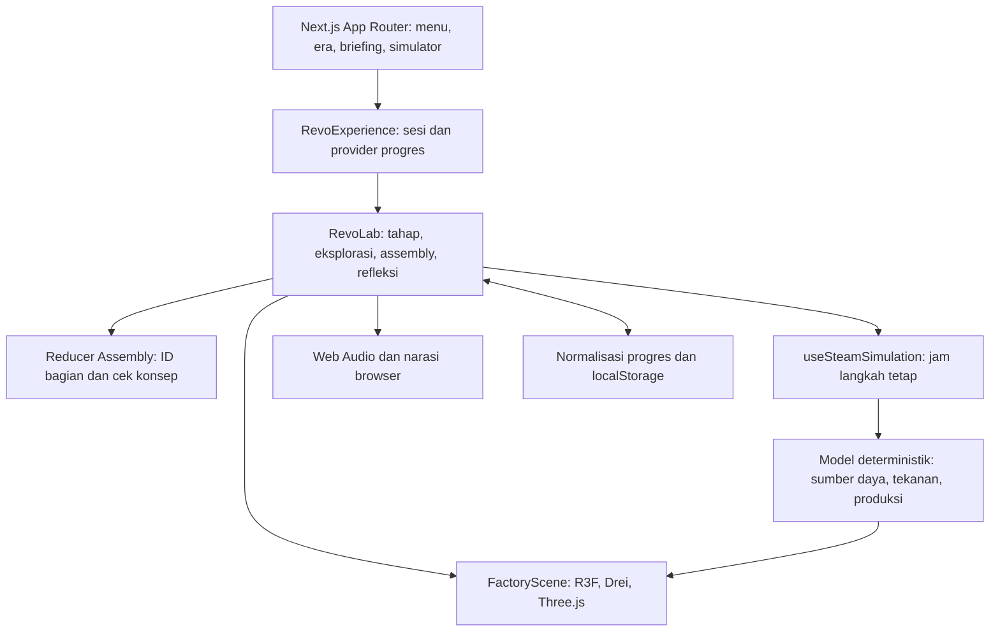

# Kerangka presentasi dosen

Versi REVO-008, 1 November 2026, berdasarkan kode `a4c135d`. Kerangka sekitar 10–12 menit ditambah demo 8–12 menit; durasi dapat disesuaikan. Dokumen ini adalah outline isi dan catatan bicara, bukan deck PowerPoint yang sudah dibuat atau hasil seminar.

## Susunan slide dan catatan presenter

| Slide / topik | Isi utama yang dapat ditampilkan | Catatan bicara dan bukti |
| --- | --- | --- |
| 1 — Latar belakang | REVO — Jelajah Revolusi Industri; pembelajaran hubungan teknologi dan perubahan masyarakat; fokus Industry 1.0 | Gunakan [pratinjau pabrik](../../public/revo/factory-preview.png). Nyatakan proyek prototipe pembelajaran yang siap diajukan untuk review; belum tervalidasi kelas |
| 2 — Masalah pendidikan dan solusi | Tantangan menghubungkan nama komponen dengan fungsi, produksi, dan dampak; solusi berupa eksplorasi–merakit–mencoba–merefleksi | Jelaskan sebagai rasional desain. Jangan menampilkan angka masalah, hasil survei, atau klaim peningkatan tanpa data |
| 3 — Konsep dan pengguna | Bahasa Indonesia; konteks SMA; guru pendamping; Industry 1.0 dapat dimainkan, era 2–4 masih terkunci | Tampilkan [menu](media/main-menu-desktop.png); sasaran fase/CP/TP menunggu konfirmasi. Nama sekolah pada UI bukan bukti endorsement |
| 4 — Komponen multimedia | Teks dan transkrip; model 3D prosedural dan animasi; ilustrasi; efek suara opt-in; sintesis narasi Indonesia | [HUD desktop](media/gameplay-hud-desktop.png). Suara bukan rekaman mesin historis. Voice bergantung browser/OS; fallback teks tersedia |
| 5 — Alur pembelajaran | Menu → era → briefing → eksplorasi 5/5 → perakitan 5/5 dan cek 3/3 → eksperimen → refleksi → hasil | Gunakan tabel alur [overview](01-project-overview.md). Jelaskan gerbang state; briefing tidak dipaksa bila URL simulator dibuka langsung |
| 6 — 3D Assembly Puzzle | Lima komponen; hubungan mekanis; socket tetap; snap/penolakan; petunjuk; alternatif keyboard/panel | Bandingkan [salah](media/assembly-feedback-wrong-target.png) dan [selesai](media/assembly-feedback-correct-snap.png). Kecocokan posisi tidak cukup membuktikan pemahaman; siswa harus menjelaskan alasan |
| 7 — Simulasi mesin uap | Air, bahan bakar, panas, tekanan, gerak, produksi; 100 unit dan batas 75; penghentian darurat 90; pause dan retry | [HUD desktop](media/gameplay-hud-desktop.png). Semua angka skala edukasi; bukan bar, °C, efisiensi, atau pelatihan keselamatan ketel |
| 8 — Integrasi pengetahuan dan asesmen | Lima LO; tiga cek perakitan dengan retry; tiga refleksi dengan penjelasan; pre/post dan observasi sebagai pelengkap | Ringkas [matriks](02-learning-outcomes.md). Hasil level tidak mensyaratkan 3/3 refleksi. Hindari menyebut 5/5 eksplorasi sebagai penguasaan lima konsep |
| 9 — Arsitektur teknologi | Next.js/React/TypeScript; React Three Fiber/Drei/Three.js; model simulasi murni; state dan localStorage; Web Audio/SpeechSynthesis | Diagram di bawah; sumber [package.json](../../package.json), `RevoLab`, `progress.ts`, dan hook simulasi/audio. Tidak ada backend database/login/LMS |
| 10 — Demonstrasi | Jalankan [skenario demo](05-demo-script.md); beri pertanyaan prediksi dan alasan; tunjukkan fallback | Siapkan [video](media/revo-007-interactive-demo.webm). Label “rekaman otomatis dengan data demonstrasi”; bukan perjalanan siswa tanpa bantuan |
| 11 — Hasil teknis vs bukti akademik | Implementasi alur tersedia; build dan satu skenario media diperiksa pada REVO-008; instrumen dan audit disiapkan | [Checklist hasil](07-release-checklist.md#verifikasi-pada-revo-008). Jangan menyebut seluruh regression suite diulang pada checkpoint ini. Tidak ada hasil validasi guru, skor siswa, atau klaim efektivitas |
| 12 — Batas, rencana, dan permohonan review | Model historis gabungan; pembabakan sederhana; progres per-browser; kompatibilitas perangkat; materi H01–H13; keputusan guru/PM | [Hasil desktop](media/level-completed-desktop.png) diberi label fixture. Prioritas berikutnya: keputusan isi, validasi instrumen, pilot kelas dan kesiapan rilis. Era selanjutnya hanya rencana tanpa jadwal |

## Diagram arsitektur untuk slide 9

Geometri/animasi menampilkan state; state reducer dan aturan model menentukan kelulusan, bukan posisi visual semata. Data perangkat tidak menjadi rekam nilai guru. Fallback antarmuka tetap berguna ketika grafis/audio tidak tersedia.

## Pesan yang perlu dinyatakan secara eksplisit

1. **Yang selesai:** pengalaman Industry 1.0 dan paket review akademik; mekanik tidak dikembangkan ulang pada tugas ini.
2. **Yang sedang dimintakan:** konfirmasi materi, kesesuaian kelas/kurikulum, serta izin rancangan uji terbatas melalui proses sekolah/universitas.
3. **Yang belum ada:** nilai validasi ahli, feedback siswa, bukti peningkatan, deployment produksi yang diverifikasi, dan era 2–4 yang playable.

Contoh penutup: “REVO sudah dapat mendemonstrasikan hubungan komponen dan produksi dalam model sederhana. Kami memohon review atas ketepatan materi, batas penyederhanaan, dan instrumen sebelum menarik kesimpulan tentang manfaat belajarnya.”

## Pertanyaan yang mungkin diajukan dosen

| Pertanyaan | Jawaban yang sesuai implementasi |
| --- | --- |
| Mengapa puzzle bukan sekadar mencocokkan bentuk? | Fungsi dan hubungan ditampilkan, tiga cek konsep menjadi prasyarat, serta feedback menjelaskan kesalahan; tetap perlu penjelasan mandiri untuk memastikan siswa tidak hanya mengikuti petunjuk |
| Apakah ini mesin Watt tahun 1800? | Ini skema edukasi gabungan. Label waktu/kronologi dan penyederhanaannya diajukan untuk konfirmasi guru, bukan klaim replika |
| Apa bukti siswa memahami sejarah? | Belum ada data siswa. Pilihan ganda game memberi indikator terbatas; draf pre/post, uraian, dan observasi menambah bukti yang akan dikumpulkan |
| Apakah progres aman sebagai nilai? | Progres tersimpan lokal dan bisa dihapus/diubah; tidak cocok sebagai rekam nilai resmi atau bukti bebas manipulasi |
| Bagaimana jika tidak ada WebGL atau suara Indonesia? | Gunakan panel kontrol dan transkrip; backup gambar/video menampilkan bagian visual. Kesiapan perangkat kelas diperiksa sebelum sesi |
| Mengapa tidak langsung mengembangkan Industry 2.0? | Fokus checkpoint ini menyelesaikan review dan validasi Industry 1.0. Era lain belum playable dan tidak menjadi bagian serah terima ini |

Sumber sejarah yang tampil pada slide materi harus diambil dari [register audit](03-content-audit.md#sumber-pembanding-yang-diperiksa), sesuai klaim yang didukung. Jangan memindahkan foto museum ke slide tanpa memeriksa hak penggunaan. Screenshot REVO pada paket mempunyai provenance di [manifest](media/manifest.json).
